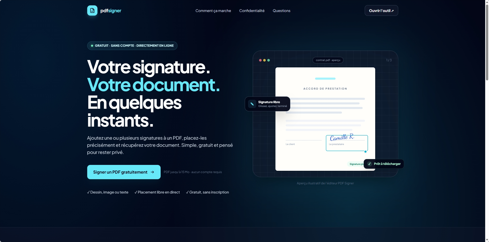

# PDF Signer (Symfony + Tailwind)

## Aperçu



Application web Symfony pour signer des PDF avec une experience visuelle complete:

- landing page publique avec présentation de l'outil
- upload et preview du PDF
- signature par dessin
- signature par image
- signature texte avec police handwriting
- signatures multiples (ajout/suppression)
- placement libre en live (déplacer + redimensionner)

## Fonctionnalités

- Upload d'un PDF (max 15 MB)
- Preview du PDF dans l'interface
- Edition de signatures:
  - Dessin au canvas
  - Import image (`png`, `jpg`, `jpeg`)
  - Texte avec polices signature:
    - Pacifico
    - Dancing Script
    - Great Vibes
    - Sacramento
    - Caveat
    - Satisfy
- Gestion de plusieurs signatures:
  - Ajouter une signature sur une page
  - Sélectionner une signature
  - Déplacer la signature dans la preview
  - Redimensionner la signature (poignée)
  - Supprimer la signature sélectionnée
  - Supprimer toutes les signatures
- Export final du PDF signe en téléchargement direct

## Stack technique

- Symfony 7.4
- Twig
- TailwindCSS (via CDN)
- PDF.js (preview canvas cote client)
- FPDI + FPDF (incrustation des signatures cote serveur)

## Prérequis

- PHP >= 8.2
- Composer >= 2
- Symfony CLI (recommande pour le serveur local)

Extensions PHP utiles:

- `fileinfo`
- `mbstring`
- `ctype`

## Workflow d'installation

Depuis le dossier du projet:

```bash
cd app
composer install
```

Puis configurer l'environnement local:

```bash
cp .env .env.local
```

Tu peux ensuite ajuster `.env.local` si besoin (APP_ENV, APP_SECRET, etc.).

## Workflow de lancement

### Option recommandée (Symfony CLI)

```bash
cd app
symfony serve
```

Ouvrir ensuite l'URL affichée par Symfony CLI (par défaut `https://127.0.0.1:8000`).

### Option alternative (serveur PHP natif)

```bash
cd app
php -S 127.0.0.1:8000 -t public
```

Puis ouvrir:

- [http://127.0.0.1:8000](http://127.0.0.1:8000)

La page d'accueil présente la plateforme. Cliquez sur **Signer un PDF gratuitement** pour ouvrir l'éditeur à `/signer`.

## Workflow utilisateur (dans l'app)

1. Depuis l'accueil, ouvrir l'éditeur et importer un PDF.
2. Choisir le mode de signature (dessin, image, texte).
3. Cliquer sur `Ajouter cette signature`.
4. Positionner/redimensionner la signature dans la preview.
5. Refaire les étapes 2-4 pour ajouter plusieurs signatures.
6. Cliquer sur `Générer le PDF signé`.

## Structure utile

- `src/Controller/PdfSignController.php`: endpoints upload/preview/sign/reset
- `src/Service/PdfSigner.php`: application des signatures dans le PDF
- `templates/landing/index.html.twig`: landing page et présentation de la plateforme
- `templates/pdf_sign/index.html.twig`: interface principale
- `public/js/signature.js`: logique front (preview live, drag/resize, multi-signatures)

## Notes

- Aucun compte ni historique de documents n'est créé. Les PDF uploadés sont traités temporairement côté serveur dans `var/storage/pdfs`, avec leur référence conservée dans la session.
- Les rendus de signatures et PDF signés transitent par `var/storage/signatures` et `var/storage/signed`.
- Après la génération réussie, le PDF source et la référence de session sont supprimés; le PDF signé est supprimé du disque après son envoi au navigateur (`deleteFileAfterSend`). Le bouton de suppression de document efface aussi le PDF source temporaire.
